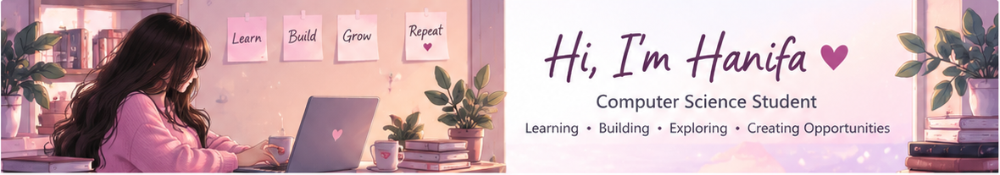
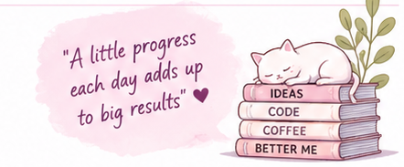

<!--
  GitHub Profile README for Hanifa Alvi (@Hanifaalvi).
  This file and the assets/ folder go in the PUBLIC repository called Hanifaalvi.
  The banner and second illustration were made specifically for this profile.
  NOTE: Project descriptions are learning plans/in-progress work, not professional experience.
-->

  

  

  
  
  

---

## 🌷 A little about me

Hello! I'm **Hanifa Alvi**, a **Computer Science student** discovering the world of technology through hands-on learning and creative projects.

I'm especially curious about **software development, web applications, interactive games, and data**. Right now, I'm focused on understanding the fundamentals, writing code regularly, and turning ideas into projects I can learn from.

- 💻 **Currently learning:** Python, JavaScript, SQL, HTML & CSS
- 🎮 **Building and practicing:** Small browser games and web applications
- 🧠 **Exploring:** Software engineering, data engineering, IT and emerging technologies
- 🌱 **Learning style:** Understand it → try it → build it → improve it
- 🎯 **Long-term goal:** Grow into a versatile developer through real projects and consistent practice

*"Big journeys begin with small programs."* ✨

 

---

## 🧰 My learning toolbox

**Languages & web basics I'm learning**

  

**Tools I'm practicing with**

  

  
  
  

These are technologies I'm <b>learning or exploring</b>, not claims of professional-level expertise.

---

## 🎀 My little project studio

I enjoy learning by experimenting. Here's what I'm currently working toward; I'll link the actual repositories as my projects become ready to share.

| Project | What I'm practicing | Progress |
|:--|:--|:--|
| 🍉 **Fruit Slice Game** | JavaScript logic, mouse/touch events, scoring, animation and debugging | 🧩 Learning / in progress |
| 🕹️ **Mini Game Hub** | HTML, CSS, JavaScript, page navigation and responsive design | 🧩 Learning / in progress |
| 🐍 **Python Mini Lab** | Variables, loops, functions, files and small automation ideas | 📝 Planned learning project |
| 🗄️ **SQL Practice Notebook** | SELECT, filtering, JOINs, grouping and basic data analysis | 📝 Planned learning project |

> As I publish each project, I'll add its source code, screenshots, instructions and what I learned.

<!-- Once a project exists, change its title into a link, for example:
[🍉 Fruit Slice Game](https://github.com/Hanifaalvi/REAL_REPOSITORY_NAME)
Do not mark a project as complete until it's actually complete. -->

---

## 🌸 My learning roadmap

- [ ] Publish my first playable browser game
- [ ] Make a responsive multi-page web application
- [ ] Write useful beginner-level Python programs
- [ ] Practice SQL queries using sample datasets
- [ ] Learn Git branching, pull requests and code reviews
- [ ] Document what I build, including problems I solved

*I'll check these off as I complete them.*

---

## 📊 Growing on GitHub

  
  

These charts use public repository activity, so they will evolve as I publish code. The charts rely on an external service and might occasionally be unavailable.

---

## 💌 Let's connect

I'm here to learn, explore new ideas, share beginner projects, and meet people who enjoy building things with technology.

  
  

  <b>🌷 Learn something. Build something. Keep growing. 🌷</b>

  

